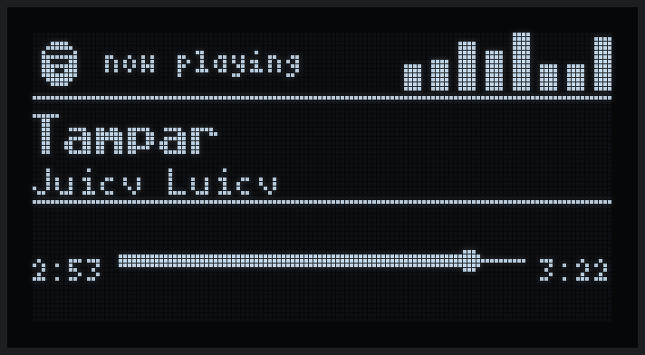
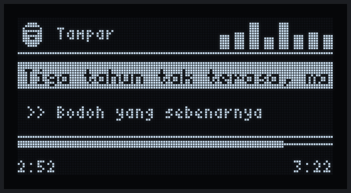
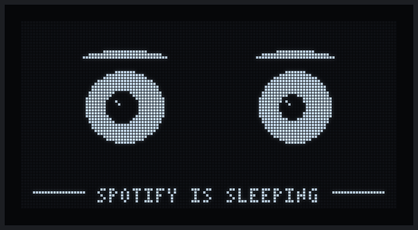

# 🎵 Spotify OLED Display — ESP32 + Spotify Web API

Shows the track you're playing on Spotify **in real time** on a 1.3" SH1106 OLED (128×64), with **synced lyrics**, a progress bar, an equalizer and animated idle faces.

> 🙏 **Credit:** this is a fork of [**EkiZR/Spotify-ESP32**](https://github.com/EkiZR/Spotify-ESP32) by **EkiZR** ([Instagram](https://www.instagram.com/ekizr_/)). The ESP32 firmware, the OLED UI, the lyrics logic and the original idea are all theirs. Thank you EkiZR! ❤️
>
> This fork only swaps the **Discord bot** backend for one that reads playback straight from the **Spotify Web API**, so you don't need a Discord bot, a Discord server or Rich Presence.

## 📸 Screens

| Now playing | Synced lyrics |
|---|---|
|  |  |
| **Idle (nothing playing)** | **Boot** |
|  |  |

<sub>Rendered by running the unmodified `esp32.ino` drawing code through the real U8g2 library on a PC. See [`tools/oled-sim`](#-oled-simulator). Pixel-exact, just without the camera glare.</sub>

---

## 🧠 How It Works

```
Spotify Web API ──► spotify_server.py (Python, on your server)
                         │
                    Synced lyrics from lrclib.net
                         │
                    HTTP JSON at :3000/now-playing
                         │
                    ESP32 polls every 2 s ──► SH1106 OLED
```

1. `spotify_server.py` polls Spotify's *currently playing* endpoint every 3 seconds.
2. When the track changes it fetches timestamped lyrics from [lrclib.net](https://lrclib.net) (free, no key).
3. It serves the same `/now-playing` JSON the original Discord bot did, so **`esp32.ino` is unchanged**.

### What changed from the original

| | Original (`bot.py`) | This fork (`spotify_server.py`) |
|---|---|---|
| Data source | Discord Rich Presence | Spotify Web API |
| Needs | Discord bot token, server, presence intent | Spotify app **Client ID** only |
| Auth | Bot token | OAuth PKCE (no client secret), auto-refreshing token |
| Works while Discord is closed / Invisible | ❌ | ✅ |
| Paused tracks | Still shown as playing | Reported as not playing |
| Lyrics lookup | artist + title | first artist + title + album + duration (better matches) |

---

## 🖥️ Section 1 — Server Setup

Any always-on machine on the same network as the ESP32 works (home server, Raspberry Pi, PC).

### 1. Create a Spotify app

1. Go to the [Spotify Developer Dashboard](https://developer.spotify.com/dashboard) → **Create app**.
2. Set **Redirect URI** to exactly `http://127.0.0.1:8888/callback`.
3. Tick **Web API**, save, and copy the **Client ID**.

### 2. Install

```bash
git clone https://github.com/AetherVoyager/Spotify-ESP32
cd Spotify-ESP32
python3 -m venv venv
venv/bin/pip install aiohttp
```

Put your Client ID at the top of `spotify_server.py`:

```python
CLIENT_ID  = "your_client_id"
PORT       = 3000
LYRIC_LEAD = 2.4   # show lyrics slightly early (seconds)
```

### 3. Authorize (one time)

```bash
venv/bin/python spotify_server.py auth-url
```

Open the printed link in **any** browser (your phone or PC is fine, it doesn't have to be the server) and click **Agree**. You'll land on a `http://127.0.0.1:8888/callback?code=...` page that **fails to load. That's expected.** Copy that whole address and run:

```bash
venv/bin/python spotify_server.py auth-code "http://127.0.0.1:8888/callback?code=..."
```

This saves `spotify_token.json` (git-ignored). It refreshes itself, so you only do this once.

### 4. Run

```bash
venv/bin/python spotify_server.py
```

#### Run 24/7 with systemd (Linux)

`/etc/systemd/system/spotify-esp32.service`:

```ini
[Unit]
Description=Spotify now-playing server for ESP32 OLED
After=network-online.target
Wants=network-online.target

[Service]
WorkingDirectory=/opt/spotify-esp32
ExecStart=/opt/spotify-esp32/venv/bin/python -u spotify_server.py
Restart=always
RestartSec=5

[Install]
WantedBy=multi-user.target
```

```bash
sudo systemctl daemon-reload
sudo systemctl enable --now spotify-esp32
journalctl -u spotify-esp32 -f
```

If you use a firewall, allow port 3000 from your LAN (e.g. `sudo ufw allow from 192.168.1.0/24 to any port 3000`).

---

## 🔌 Section 2 — ESP32

### Hardware

| Component | Model |
| --- | --- |
| ESP32 DevKit | NodeMCU ESP32, WEMOS D1 R32, etc. |
| OLED | SH1106 1.3" 128×64 (I2C) |
| Wires | Female-to-female jumpers |

### Wiring

```
ESP32        SH1106 OLED
GPIO 21 ───► SDA
GPIO 22 ───► SCL
3.3V    ───► VCC
GND     ───► GND
```

### Configure `esp32.ino`

```cpp
const char* WIFI_SSID  = "Your_WiFi_Name";
const char* WIFI_PASS  = "Your_WiFi_Password";
const char* SERVER_URL = "http://192.168.1.50:3000/now-playing"; // your server's LAN IP
```

Use the server's **LAN** IP, not `127.0.0.1`. The ESP32 can't join Tailscale or other VPNs either.

### Flash

**Arduino IDE:** install the **esp32** board package and the **U8g2** and **ArduinoJson** libraries, pick **ESP32 Dev Module**, then Upload.

**arduino-cli** (headless, e.g. ESP32 plugged into the server):

```bash
arduino-cli config add board_manager.additional_urls https://espressif.github.io/arduino-esp32/package_esp32_index.json
arduino-cli core update-index && arduino-cli core install esp32:esp32
arduino-cli lib install U8g2 ArduinoJson
mkdir esp32 && cp esp32.ino esp32/
arduino-cli compile --fqbn esp32:esp32:esp32 --upload -p /dev/ttyUSB0 esp32
```

---

## 🔧 Troubleshooting

- **`[FETCH] HTTP code: -1` on the serial monitor:** the ESP32 can't reach the server. Check that the server is running, `SERVER_URL` uses the right LAN IP, both are on the same network, and port 3000 isn't firewalled.
- **Always `"playing": false`:** nothing is playing, playback is paused, or it's a podcast/ad. Check `GET /debug`.
- **`token refresh failed` in the log:** run the `auth-url` / `auth-code` steps again.
- **No lyrics:** lrclib.net doesn't have that song. The title, artist and progress bar still show.
- **Blank lyric bar for non-Latin songs (Malayalam, Hindi, Japanese, …):** the sketch's U8g2 fonts (`_tr`) only contain ASCII, so those characters aren't drawn.
- **Upload hangs at "Hard resetting via RTS pin...":** press the board's **EN/RST** button.
- **Flash usage warning:** set Partition Scheme to **Huge APP (3MB No OTA)**.

---

## 📡 API

### `GET /now-playing`

```json
{
  "playing": true,
  "title": "Tampar",
  "artist": "Juicy Luicy",
  "position_ms": 171136,
  "duration_ms": 202824,
  "lyric_prev": "Tutup air mata",
  "lyric_curr": "Tiga tahun tak terasa, masih kau yang ada",
  "lyric_next": "Bodoh yang sebenarnya"
}
```

### `GET /debug`

Current track state plus the first few loaded lyric lines.

---

## 🖼️ OLED Simulator

`tools/oled-sim` compiles the sketch's drawing code for Linux against the real U8g2 C library (with tiny Arduino/WiFi stubs) and records every frame the sketch would send to the display. Use it to preview UI changes without flashing.

```bash
cd tools/oled-sim
./build.sh ../../esp32.ino ~/Arduino/libraries/U8g2/src/clib   # needs gcc/g++
pip install pillow

./sim lyrics out.bin 200 "Title" "Artist" 60000 200000 "Current line" "Next line"
python render.py out.bin lyrics.png 30          # one frame -> PNG
./sim idle idle.bin 400 && python render.py idle.bin idle.gif 0:400:2 80   # animation -> GIF
```

Modes: `boot`, `play`, `lyrics`, `idle`.

---

## ❤️ Credits

- **[EkiZR](https://github.com/EkiZR)** created the original [Spotify-ESP32](https://github.com/EkiZR/Spotify-ESP32) project: the ESP32 firmware, OLED UI, animations and lyrics sync. Instagram: [@ekizr_](https://www.instagram.com/ekizr_/). All the hard work on the display side is theirs.
- **[lrclib.net](https://lrclib.net)** for the free synced lyrics API.
- **[U8g2](https://github.com/olikraus/u8g2)** and **[ArduinoJson](https://arduinojson.org)**.
